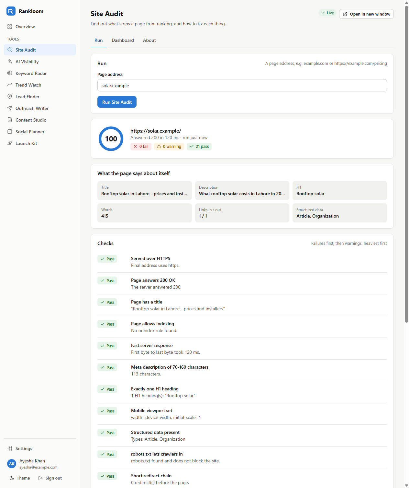
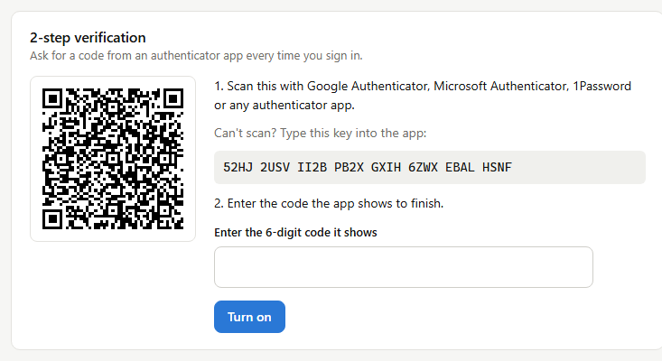

# Rankloom

One workspace of growth tools for small businesses and makers: audit a site, check whether AI
answer engines mention you, find keywords and trends, find leads, write outreach, plan content
and social posts, and launch a GitHub project. One account, one sidebar, every tool openable
in a window of its own so several can sit side by side.


## The tools

| Tool | What it does | Status |
|---|---|---|
| [Site Audit](rankloom/engines/site_audit.py) | 21 on-page and technical checks on a page, each with its fix, scored out of 100 | **Live** |
| [AI Visibility](rankloom/tools.py) | Whether ChatGPT-style answer engines name your business for your customers' questions | Being built |
| [Keyword Radar](rankloom/tools.py) | A seed topic expanded into searches grouped by intent, with Urdu and Roman Urdu variants | Being built |
| [Trend Watch](rankloom/tools.py) | Terms rising faster than their normal range across search, Reddit, YouTube and news | Being built |
| [Lead Finder](rankloom/tools.py) | Local businesses whose websites are losing them customers, ranked by how much a fix helps | Being built |
| [Outreach Writer](rankloom/tools.py) | A first message that quotes the prospect's own audit; drafts only, never bulk-sent | Being built |
| [Content Studio](rankloom/tools.py) | A keyword group turned into a brief and a draft, with every factual claim marked | Being built |
| [Social Planner](rankloom/tools.py) | One piece of content split into a calendar of posts per network, sent only on approval | Being built |
| [Launch Kit](rankloom/tools.py) | An imported GitHub repo's README fixes, launch posts and where to share it | Being built |

Every tool already has its page, its About panel, its run form and a dashboard that records
visits and runs. A tool that is not live says so and refuses to run; it never returns
something that looks like a result.

## Input / Output

`uv run python demo.py` audits two fixture pages whose problems are known, with no network:

```
Input : https://solar.example/
Output: 100/100  (0 fail, 0 warn, 21 pass)

Input : http://bad.example/
Output: 36/100  (7 fail, 11 warn, 3 pass)
  FAIL  Served over HTTPS: Final address uses http.
  FAIL  Page has a title: No <title> element.
  FAIL  Page allows indexing: A robots rule says noindex.
  FAIL  Meta description of 70-160 characters: No meta description.
  FAIL  Mobile viewport set: No viewport meta tag.
  FAIL  robots.txt lets crawlers in: robots.txt blocks every crawler with Disallow: /.
  FAIL  Images have alt text: 3 of 3 images have no alt attribute.
  WARN  Exactly one H1 heading: 2 H1 heading(s): "One", "Two"
  WARN  Structured data present: No JSON-LD structured data. 1 block(s) are not valid JSON.
  WARN  Short redirect chain: 2 redirect(s) before the page. http://bad.example -> http://www.bad.example/
  ...
```

`uv run python demo.py --live https://www.python.org/` runs the same checks on a real page
(87/100 on 2026-10-20: no failures; warnings for response time, description length, H1 count,
compression, canonical and sitemap).

| Site Audit result | Tool dashboard |
|---|---|
|  |  |

| 2-step setup | Phone |
|---|---|
|  |  |

## Run it

```bash
uv sync
uv run python -m rankloom.server --port 8130     # then open http://127.0.0.1:8130
```

or `run.bat` on Windows. Data (SQLite database and the app key) goes in `data/`, which git
ignores.

| Setting | What it does |
|---|---|
| `RANKLOOM_BASE_URL` | The public address, used for links in emails and the GitHub callback. An `https://` value turns on Secure cookies. |
| `RANKLOOM_SECRET` | App key for sealing stored tokens. Without it a random key is created in `data/app.key`. |
| `RANKLOOM_SMTP_HOST`, `_PORT`, `_USER`, `_PASSWORD`, `_FROM` | Mail for password resets. Without it, the reset link is printed to the server console and kept in the `outbox` table. |
| `RANKLOOM_GITHUB_CLIENT_ID`, `_CLIENT_SECRET` | A GitHub OAuth app, for "Connect with GitHub". Without it, users connect with a personal access token. |

## Accounts and security

- **Register, sign in, sign out, change password, forgot password** (one-hour single-use link),
  **2-step verification** (any authenticator app, QR or typed key, ten one-time recovery codes),
  and a **device list** where any other session can be signed out.
- Passwords are hashed with scrypt. Sessions are 256-bit random tokens in an HttpOnly,
  SameSite=Lax cookie; only their SHA-256 is stored.
- A password change ends every other session; a reset ends all of them. A sign-in that still
  owes a 2-step code reaches nothing, and is promoted by a **new** token, not by flipping a flag.
- 2-step codes cannot be replayed: the last step used is stored and refused.
- Every state-changing request needs a custom header and a matching Origin, which a cross-site
  form cannot send. Sign-in, 2-step, sign-up, reset, runs and GitHub calls are rate limited.
- Reset links are built from `RANKLOOM_BASE_URL`, never from the request's Host header.
- GitHub tokens and 2-step secrets are sealed (HMAC-SHA256 counter-mode keystream with an
  encrypt-then-MAC tag) and never sent back to the browser.
- Site Audit fetches only public addresses on ports 80 and 443. Every redirect hop is checked
  again, and the socket connects to the address that was checked, so a name cannot resolve to
  a public address for the check and a private one for the connection.
- Pages ship a strict Content-Security-Policy (scripts and styles from this origin only), and
  every piece of user data reaches the page through `textContent`.

## GitHub

Settings → GitHub connects an account, lists its repositories, and imports one: name,
description, default branch, languages and file count. Imported repositories feed Launch Kit.
Rankloom only reads; it never writes to a repository.

## Checks

```bash
uv run pytest                      # 82 tests: RFC 6238 vectors, the address guard, every audit check, the HTTP API end to end
uv run ruff check . && uv run ruff format --check .
uv run python scripts/ui_check.py  # headless Chrome: register, two audits, dashboard, 2-step on and back in, phone width
```

`ui_check.py` drives the real server in headless Chrome over the DevTools protocol with no
dependencies, fails on any console error or Content-Security-Policy refusal, and writes the
screenshots above.

## What it does not do

- Eight of the nine tools have no engine yet. Their pages, forms and dashboards are built;
  running them returns "being built".
- It does not generate traffic, post in bulk, or send outreach by itself. Bulk automation gets
  accounts and domains blocked and earns no rankings.
- It does not render JavaScript. Site Audit reads the HTML the server sends, as most crawlers'
  first pass does; content a script adds later is not seen.
- Email needs an SMTP server; without one, reset links go to the server console.
- One server process with SQLite. It is sized for a team, not for a public SaaS launch.

## Layout

```
rankloom/
  server.py        HTTP server, routes, accounts, runs, analytics, GitHub
  security.py      scrypt, TOTP, recovery codes, sealed box
  netguard.py      public-address-only fetching
  tools.py         the nine tools: about, input, output, fields, status
  engines/         one module per live tool
  github.py, mail.py, db.py
static/            the single-page app (no framework, no build step)
scripts/           headless-browser walk-through
tests/
```

Private. © Muhammad Hammas.
