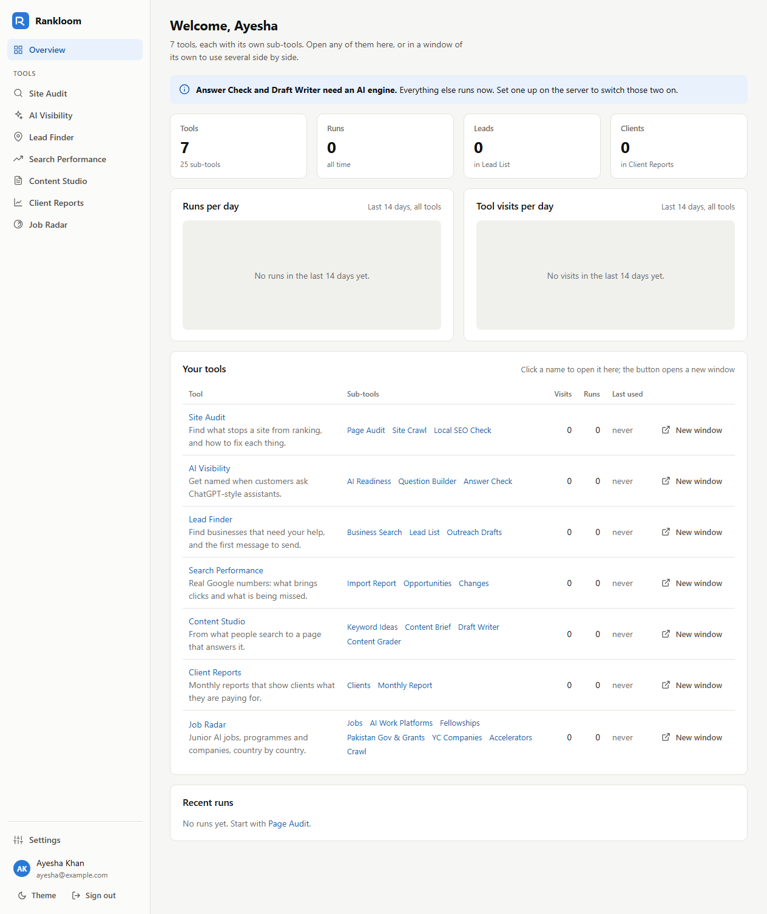
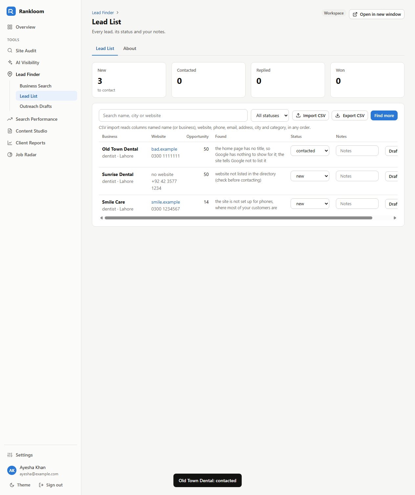
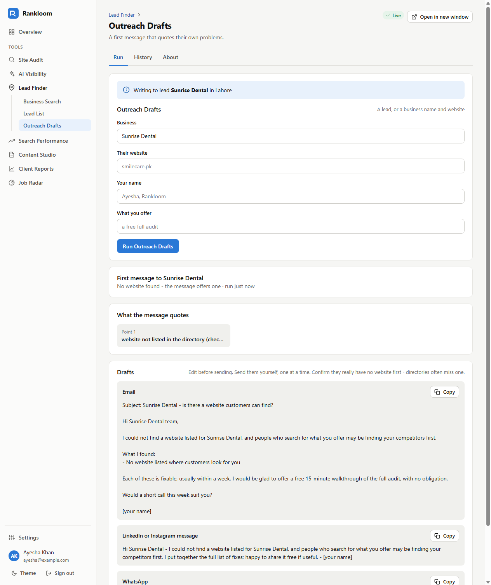
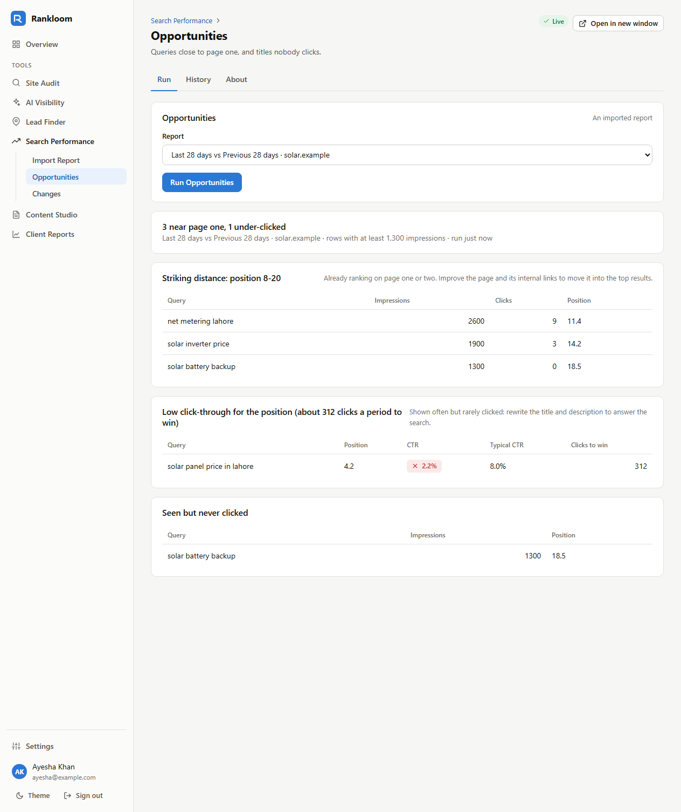
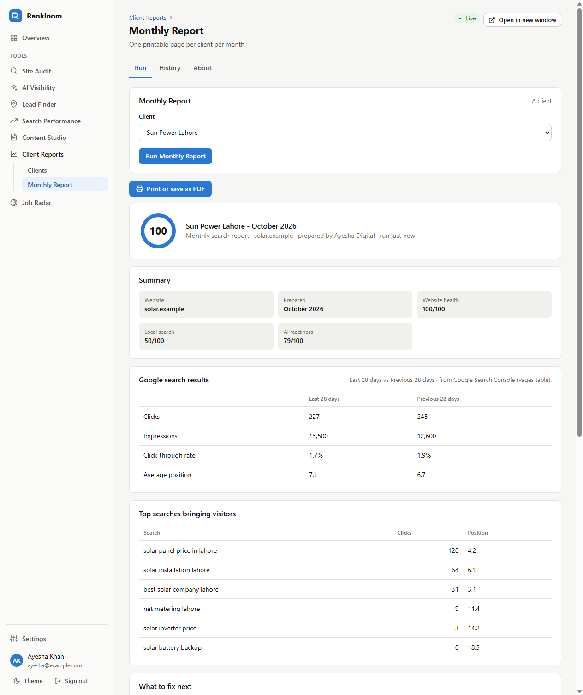
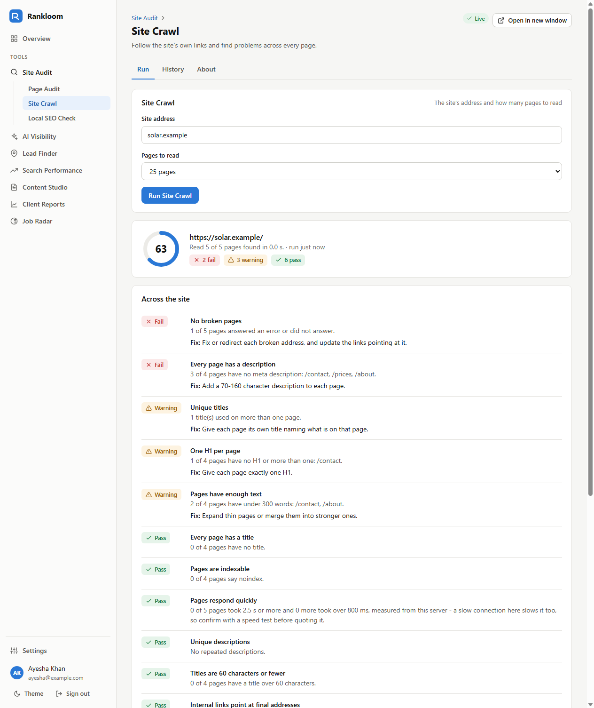
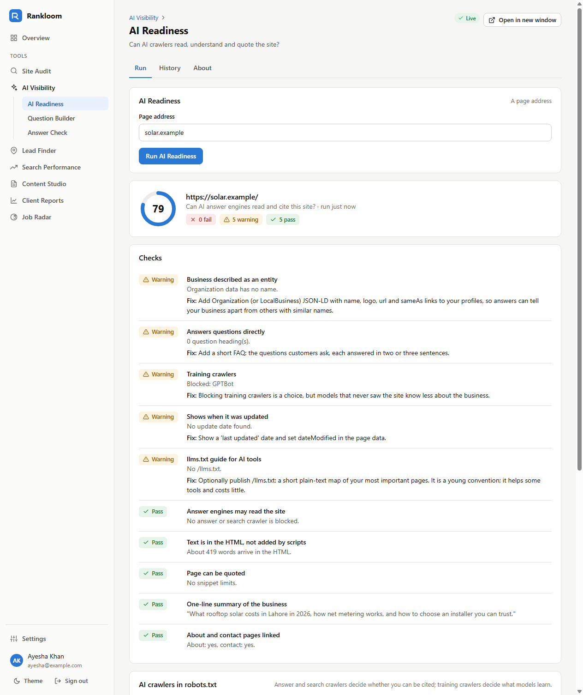
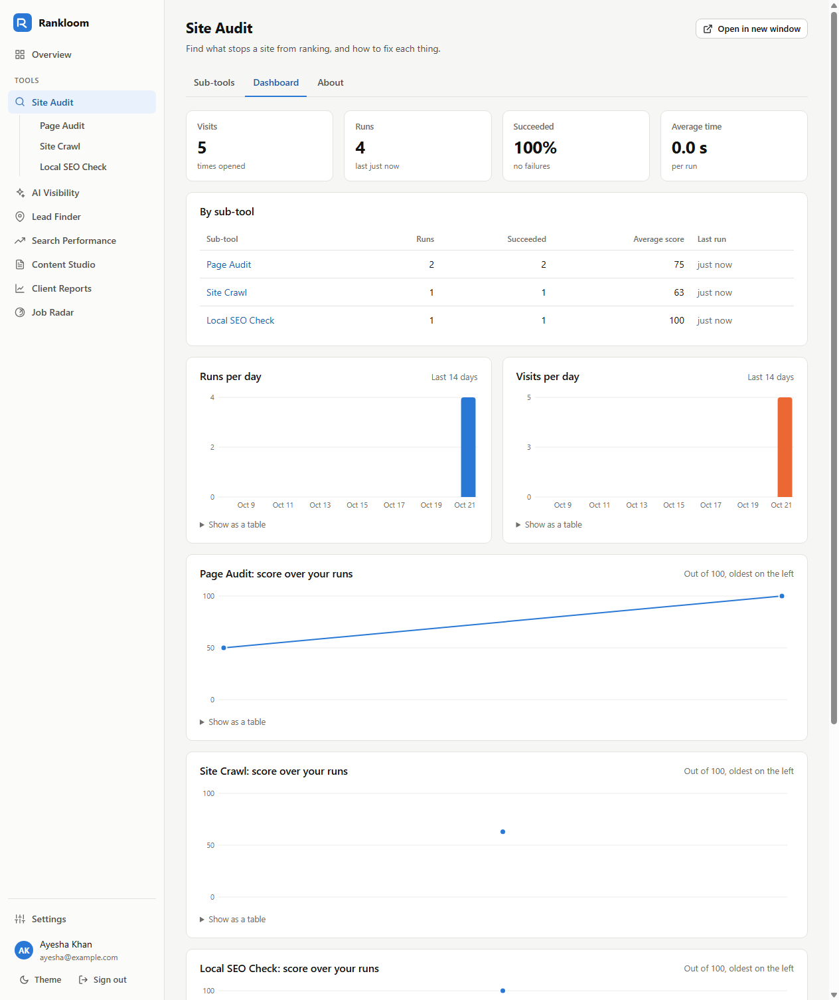
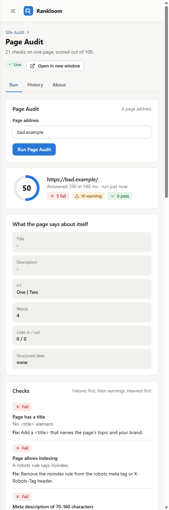

# Rankloom

A growth workspace for selling SEO and AI-visibility work to small businesses: find the
businesses that need help, audit their sites, show them whether AI assistants recommend them,
do the monthly content work, and send a report that shows the result. Six tools, each with its
own sub-tools, one account, and every tool or sub-tool openable in a window of its own so
several can sit side by side.



## The tools

| Tool | Sub-tools | What it is for |
|---|---|---|
| [Site Audit](rankloom/engines/site_audit.py) | Page Audit · Site Crawl · Local SEO Check | The free audit that opens a conversation, and the paid audit-and-fix job |
| [AI Visibility](rankloom/engines/ai_visibility.py) | AI Readiness · Question Builder · Answer Check | Whether ChatGPT-style assistants can read a site, and whether they name the business |
| [Lead Finder](rankloom/engines/leads.py) | Business Search · Lead List · Outreach Drafts | Finding clients: businesses with weak sites, a pipeline, and first messages that quote their problems |
| [Search Performance](rankloom/engines/search_perf.py) | Import Report · Opportunities · Changes | Real Google numbers from Search Console: where clicks are won, missed and lost |
| [Content Studio](rankloom/engines/content.py) | Keyword Ideas · Content Brief · Draft Writer · Content Grader | The monthly retainer work: what people search, a brief, a checked draft, a grade |
| [Client Reports](rankloom/engines/reports.py) | Clients · Monthly Report | A printable monthly report per client that shows what they are paying for |
| [Job Radar](rankloom/jobradar_link.py) | Jobs · AI Work Platforms · Fellowships · Pakistan Gov & Grants · YC Companies · Accelerators · Crawl | Junior AI jobs by country, programmes and companies, read from the private job-radar crawler |

Every sub-tool has a Run tab or a workspace, its own history and an About panel; every tool has
a dashboard of visits, runs and scores broken down by sub-tool. Of the eighteen sub-tools in the
first six tools, fourteen run now, two are workspaces (Lead List and Clients), and two - Answer
Check and Draft Writer - run once an AI engine is configured, and say so until then.

**Job Radar** reads the database of [job-radar](https://github.com/hammasbuilds/job-radar)
(private) read-only, and starts its crawl as a child process. Point `RANKLOOM_JOBRADAR_DIR` at
the job-radar folder (default `D:/github/job-radar`). Jobs filter by country, region, title
family (ML/DL, machine learning, deep learning, computer vision, generative AI, agentic AI),
engineer or researcher, onsite / hybrid / remote, full-time / contract / small contract, and
experience (junior only: at most two years), with a per-country chip row and an "open to me from
Pakistan" switch.

## Where the data comes from

Nothing is paid for and nothing is invented.

| Sub-tool | Source |
|---|---|
| Page Audit, Site Crawl, Local SEO, AI Readiness, Content Grader | the site itself, fetched through a public-address-only guard |
| Question Builder, Keyword Ideas, Content Brief | search-box autocomplete (Google, then Bing, then DuckDuckGo): what people type, not how often |
| Business Search | OpenStreetMap's Nominatim, at most one request a second |
| Opportunities, Changes, the report's search numbers | the client's own Google Search Console export |
| Answer Check, Draft Writer | the AI engine you configure (`RANKLOOM_AI`), local or hosted |

Every result says how many of its lookups were answered, so a thin result is never mistaken for
a whole one ("Read 10 of 164 pages found", "18 of 18 lookups answered").

## Live, on 2026-10-20

The same engines against the real internet:

| Sub-tool | Input | Output |
|---|---|---|
| Site Crawl | python.org, 10 pages | 92/100, read 10 of 164 pages found in 8.6 s |
| AI Readiness | python.org | 71/100: no Organization data, no question-shaped content, no llms.txt |
| Keyword Ideas | "solar panels", Pakistan | 170 real phrasings from 18 of 18 lookups: 60 questions, 59 comparing and buying, 28 local |
| Business Search | dentists, Manchester | 49 businesses, 16 with a website listed - from three countries until the country code was set |

That last row is why Business Search has a country field: "Manchester" alone returned dentists in
the United Kingdom, the United States and Jamaica.

## Input / Output

`uv run python demo.py` audits two fixture pages whose problems are known, with no network:

```
Input : https://solar.example/
Output: 100/100  (0 fail, 0 warn, 21 pass)

Input : http://bad.example/
Output: 36/100  (7 fail, 11 warn, 3 pass)
  FAIL  Served over HTTPS: Final address uses http.
  FAIL  Page has a title: No <title> element.
  FAIL  Page allows indexing: A robots rule says noindex.
  FAIL  Meta description of 70-160 characters: No meta description.
  FAIL  Mobile viewport set: No viewport meta tag.
  FAIL  robots.txt lets crawlers in: robots.txt blocks every crawler with Disallow: /.
  FAIL  Images have alt text: 3 of 3 images have no alt attribute: a.png, b.png, c.png.
  WARN  Exactly one H1 heading: 2 H1 heading(s): "One", "Two"
  WARN  Structured data present: No JSON-LD structured data. 1 block(s) are not valid JSON.
  WARN  Short redirect chain: 2 redirect(s) before the page. http://bad.example -> http://www.bad.example/
  ...
```

| Lead List | Outreach Drafts |
|---|---|
|  |  |

| Search Console opportunities | Monthly client report |
|---|---|
|  |  |

| Site Crawl | AI Readiness |
|---|---|
|  |  |

| Tool dashboard | Phone |
|---|---|
|  |  |

## Run it

```bash
uv sync
uv run python -m rankloom.server --port 8130     # then open http://127.0.0.1:8130
```

or `run.bat` on Windows. Data (SQLite database and the app key) goes in `data/`, which git
ignores.

| Setting | What it does |
|---|---|
| `RANKLOOM_AI`, `RANKLOOM_AI_MODEL`, `RANKLOOM_AI_URL`, `RANKLOOM_AI_KEY` | The AI engine for Answer Check and Draft Writer. `ollama` with a local model, or `openai` for any OpenAI-compatible service; a web-grounded one (e.g. Perplexity's `sonar`) measures what customers see in assistants. |
| `RANKLOOM_BASE_URL` | The public address, used for links in emails and the GitHub callback. An `https://` value turns on Secure cookies. |
| `RANKLOOM_SECRET` | App key for sealing stored tokens. Without it a random key is created in `data/app.key`. |
| `RANKLOOM_SMTP_HOST`, `_PORT`, `_USER`, `_PASSWORD`, `_FROM` | Mail for password resets. Without it, the reset link is printed to the server console and kept in the `outbox` table. |
| `RANKLOOM_GITHUB_CLIENT_ID`, `_CLIENT_SECRET` | A GitHub OAuth app, for "Connect with GitHub". Without it, users connect with a personal access token. |

## Accounts and security

- **Register, sign in, sign out, change password, forgot password** (one-hour single-use link),
  **2-step verification** (any authenticator app, QR or typed key, ten one-time recovery codes),
  a **device list** where any other session can be signed out, and **GitHub** import.
- Passwords are hashed with scrypt. Sessions are 256-bit random tokens in an HttpOnly,
  SameSite=Lax cookie; only their SHA-256 is stored.
- A password change ends every other session; a reset ends all of them. A sign-in that still
  owes a 2-step code reaches nothing, and is promoted by a **new** token, not by flipping a flag.
  2-step codes cannot be replayed.
- Every state-changing request needs a custom header and a matching Origin, which a cross-site
  form cannot send. Sign-in, 2-step, sign-up, reset, runs and GitHub calls are rate limited.
- Every user's leads, clients, reports and runs are theirs alone: each query is scoped to the
  signed-in account, and a client cannot be pointed at another account's Search Console report.
- Exported lead CSVs defuse spreadsheet formulas (a cell starting `=`, `+`, `-` or `@`).
- Reset links are built from `RANKLOOM_BASE_URL`, never from the request's Host header.
- GitHub tokens and 2-step secrets are sealed (HMAC-SHA256 counter-mode keystream with an
  encrypt-then-MAC tag) and never sent back to the browser.
- Fetching a user-typed address goes only to public addresses on ports 80 and 443, every
  redirect hop is checked again, and the socket connects to the address that was checked.
- Pages ship a strict Content-Security-Policy, and every piece of user data reaches the page
  through `textContent`.

## Checks

```bash
uv run pytest                      # 172 tests, no network: every engine, the HTTP API end to end, RFC 6238 vectors
uv run ruff check . && uv run ruff format --check .
uv run python scripts/ui_check.py  # headless Chrome: every sub-tool, Lead List, Clients, a report, 2-step, phone width
```

The test suite cannot reach the internet: a fixture makes every external source raise unless a
test supplies its own. `ui_check.py` drives the real server in headless Chrome over the DevTools
protocol, uploads a Search Console export through the real file input, fails on any console
error or Content-Security-Policy refusal, and writes the screenshots above.

## What it does not do

- It does not give search volumes or keyword difficulty. No free source has them; autocomplete
  shows what people type, not how often, and the pages say so.
- Answer Check measures the AI engine configured on the server, not every assistant at once.
- Business Search is only as complete as OpenStreetMap. In Pakistan most listings carry a phone
  but no website, so "no website listed" is shown as a lead to check, not as a fact.
- It never sends outreach, posts, or generates traffic. Drafts wait for you to send them, one at
  a time; bulk sending gets accounts and domains blocked and earns no rankings.
- It reads the HTML a server sends and does not run JavaScript, as most crawlers' first pass
  does.
- Search Performance reads the Search Console export you download; it does not connect to the
  Search Console API.
- One server process with SQLite: sized for an agency and its clients, not a public SaaS.

## Layout

```
rankloom/
  server.py        HTTP server, routes, accounts, runs, analytics, leads, clients
  tools.py         the six tools and their sub-tools: about, fields, status
  engines/         one module per tool; common.py is the result format every page renders
  sources.py       autocomplete and OpenStreetMap
  ai.py            the AI engine adapter
  security.py      scrypt, TOTP, recovery codes, sealed box
  netguard.py      public-address-only fetching
  robots.py, github.py, mail.py, db.py
static/            the single-page app (no framework, no build step)
scripts/           headless-browser walk-through
tests/
```

Private. © Muhammad Hammas.
